# Raja Rajeswari Arts Academy

## Live Demo

**Visit the Raja Rajeswari Arts Academy website:**

🔗 [View Live Website](https://raja-rajeswari-arts-academy-o80y.netlify.app/)

A responsive dance academy website built using **React.js** to present the academy, its services, classes, and gallery in an organized and engaging way.

## About the Project

**Raja Rajeswari Arts Academy** is a React-based website project designed to establish an online presence for a dance academy. It provides visitors with dedicated pages to explore the academy, learn about its offerings, and view its gallery.

The project focuses on component-based development, reusable UI elements, and a clean website structure.

## Features

- **Home Page**           – Welcoming landing page for visitors.
- **About Page**          – Dedicated section introducing the academy.
- **Classes Section**     – Displays information about academy classes.
- **Services Page**       – Presents the services offered by the academy.
- **Gallery Page**        – Showcases images through a dedicated gallery.
- **Testimonials**        – Displays visitor or student feedback.
- **Reusable Components** – Organized components for easier maintenance.
- **Navigation**          – Provides navigation between website sections and pages.


## Screenshots

Explore the different sections of the Raja Rajeswari Arts Academy website.

### Home Page

| Hero Section | About the Academy |
|---|---|
| 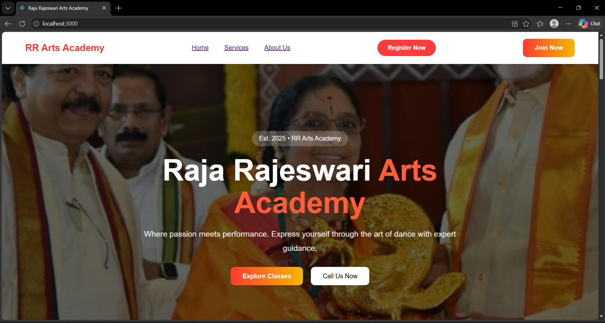 | 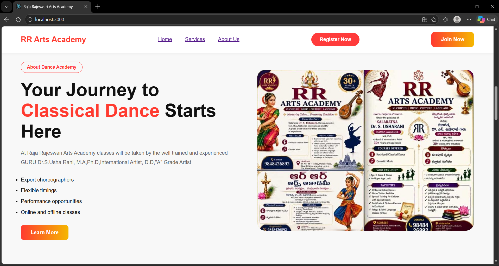 |

| Our Classes | Student Testimonials |
|---|---|
| 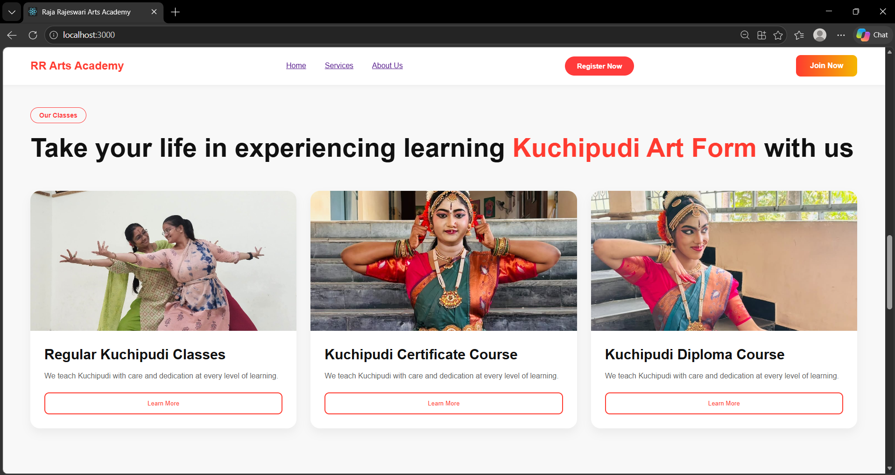 | 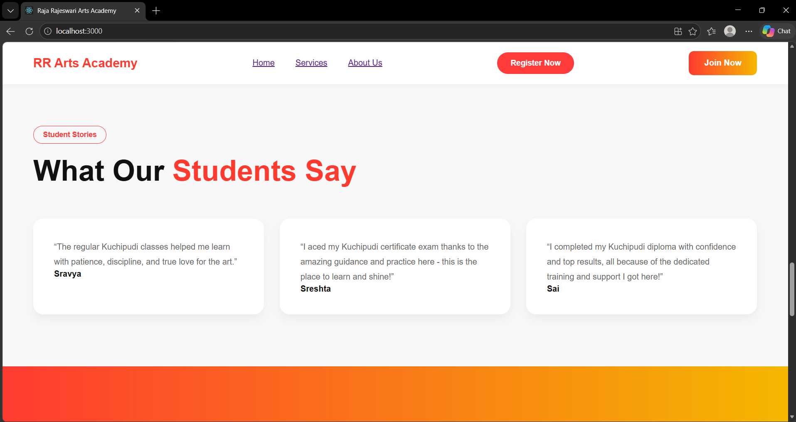 |

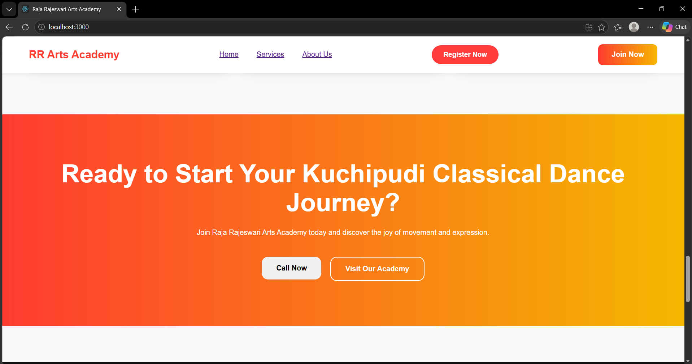

### About Us

| Our Mission | About the Guru |
|---|---|
| 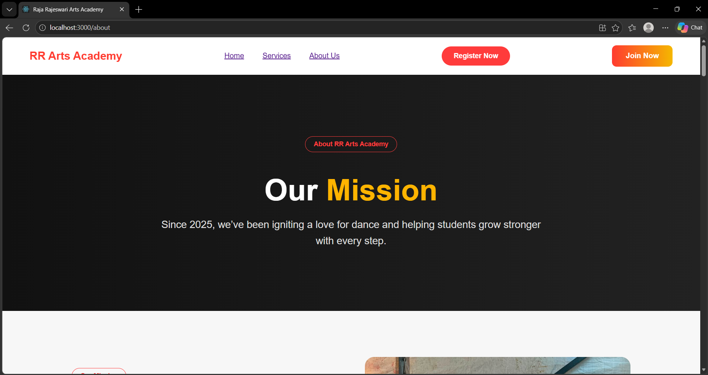 | 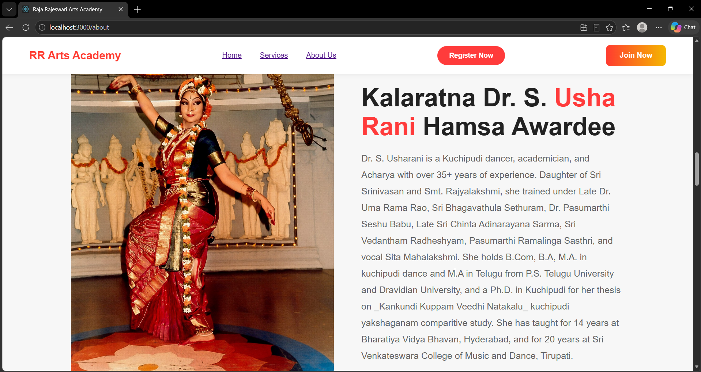 |

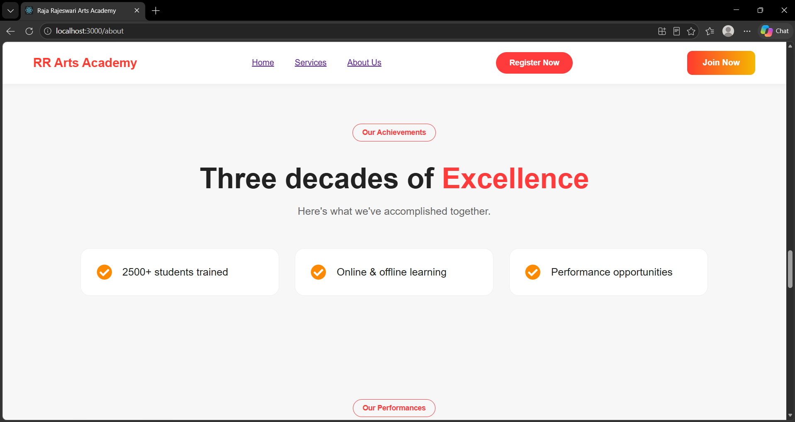

### Services

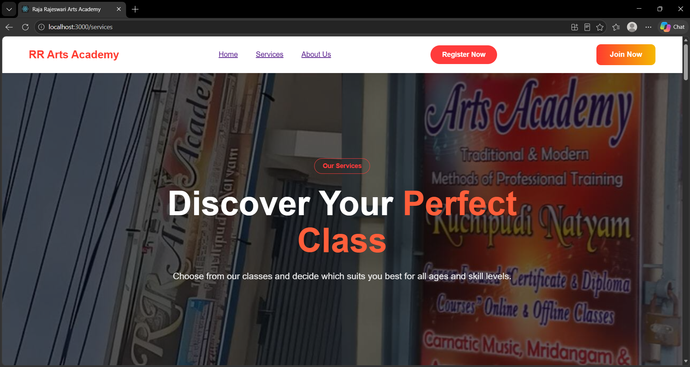

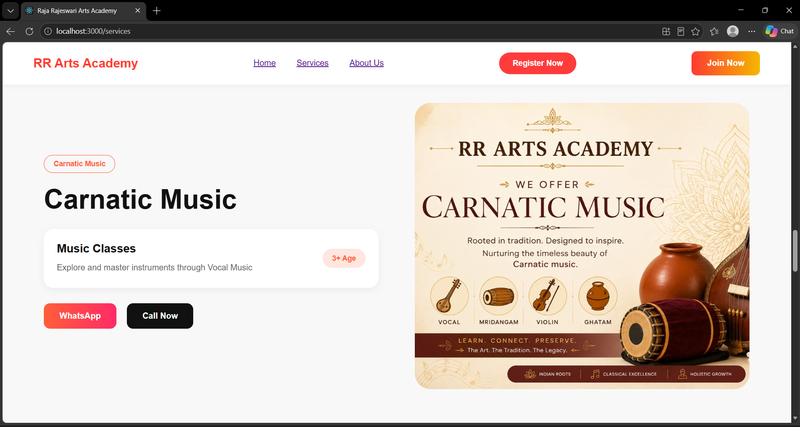

### Dance Gallery

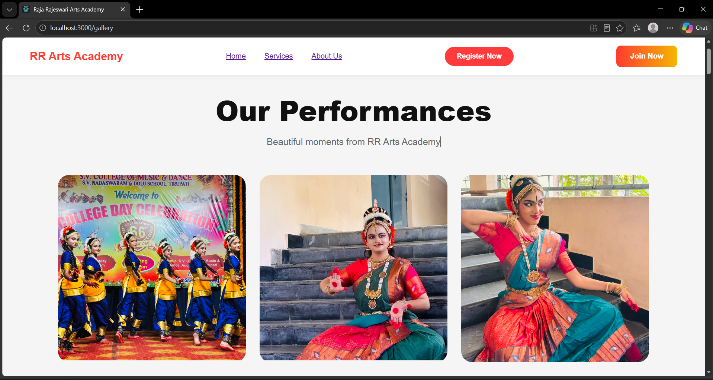

### Registration

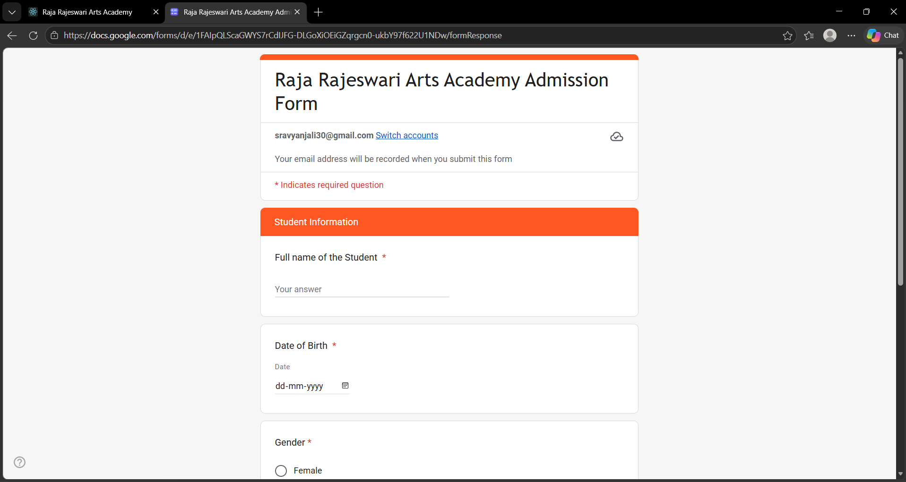


## Tech Stack

| Technology | Purpose |
|---|---|
| React.js | Frontend development |
| JavaScript | Website functionality |
| HTML5 | Website structure |
| CSS3 | Styling and layout |
| npm | Package management |
| Create React App | React project setup |

## Project Structure

dance-academy/
│
├── public/
│
├── src/
│   ├── components/
│   │   ├── Navbar
│   │   ├── Hero
│   │   ├── About
│   │   ├── Classes
│   │   ├── CTA
│   │   ├── Footer
│   │   ├── Stats
│   │   └── Testimonials
│   │
│   ├── pages/
│   │   ├── Home
│   │   ├── AboutPage
│   │   ├── Gallery
│   │   └── Services
│   │
│   └── App.js
│
├── package.json
├── package-lock.json
├── .gitignore
└── README.md

## Getting Started

Follow these steps to run the project locally.

### Prerequisites

Make sure you have installed:

- [Node.js](https://nodejs.org/)
- npm (included with Node.js)
- Git

### Installation

**1. Clone the repository**

```bash
git clone https://github.com/sravya2130/Raja-Rajeswari-Arts-Academy.git
```

**2. Navigate to the project directory**

```bash
cd Raja-Rajeswari-Arts-Academy
```

**3. Install dependencies**

```bash
npm install
```

**4. Start the development server**

```bash
npm start
```

The website will open at:

`http://localhost:3000`

## Available Scripts

| Command | Description |
|---|---|
| `npm start` | Runs the development server |
| `npm test` | Launches the test runner |
| `npm run build` | Creates an optimized production build |

## Future Improvements

- Deploy the website for public access.
- Improve accessibility and responsiveness.
- Add further interactive features.
- Optimize website performance.

## Repository

[View Raja Rajeswari Arts Academy on GitHub](https://github.com/sravya2130/Raja-Rajeswari-Arts-Academy)

---

**Developed as a frontend web development project using React.js.**

## Developed By

**SREERAM JHANSI LAKSHMI SRAVYANJALI**

- GitHub: [@sravya2130](https://github.com/sravya2130)

---

 If you find this project interesting, feel free to explore the repository!